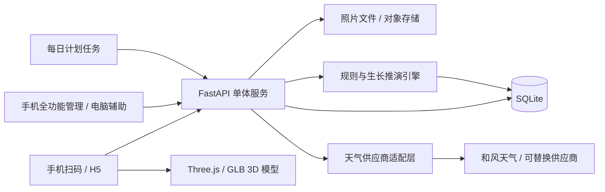

# 现实种菜管理系统开发文档（V0.2）

> 文档状态：个人使用优先，可用于启动 MVP 开发  
> 编写日期：2026-09-04  
> 默认时区：Asia/Shanghai  
> 默认地区：浙江省绍兴市越城区
> 目标终端：手机 H5 为主，电脑浏览器为辅  
> 视觉方向：原创 3D 卡通种菜游戏风格

## 1. 项目定位

本项目不是单纯的蔬菜资料页，而是一套“现实菜地数字孪生 + 轻度种菜游戏化”的管理系统：线下每块菜地、每批蔬菜、每次浇水施肥和病虫害观察，都能在线上留下记录；系统再结合蔬菜品种、生长阶段和绍兴越城区天气，给出可解释的生长推演、风险提示和待办建议。

第一阶段主要供本人管理，设计优先级依次为：手机现场操作方便、数据不丢、二维码简单直观、3D 菜地有游戏感。多人协作和严格访问控制暂不作为 MVP 前置条件，但代码保留以后开启登录的能力。

核心闭环：

1. 在地图式界面建立并自由排列地块。
2. 给地块安排某个蔬菜品种和种植批次。
3. 扫描固定二维码，快速进入对应地块。
4. 现场记录浇水、施肥、除草、打药、病虫害、照片和实际生长状态。
5. 每日天气驱动生长、缺水、杂草、病害和虫害风险模型。
6. 线上状态与线下实况互相校正，保留完整历史。

### 1.1 对现有参考页的理解

现有页面是一张“香玉白丝瓜”单品档案，已有以下信息：

- 生命周期、施肥、打药三个状态；
- 蔬菜名称和种植日期；
- 种子包装照片；
- 二维码对应一张可访问的资料页。

新系统将保留“扫码直达、现场快速修改”的优点，但把数据拆成“固定地块、可更换的种植批次、操作记录、状态快照、二维码绑定历史”五层，避免每次换季都重做页面或重印二维码。

## 2. 技术选型结论

### 2.1 推荐方案

| 层次 | 推荐技术 | 说明 |
|---|---|---|
| 移动端/管理端 | React 19 + TypeScript + Vinext + Tailwind CSS + Three.js | 同一套响应式 H5；手机可完成全部管理，Three.js 负责低多边形 3D 菜地和模型交互 |
| 后端 | Python + FastAPI | 需求和规则会频繁变化，Python 更适合快速实现天气、规则模型和后续数据分析 |
| 数据访问 | Python `sqlite3` + 版本化建表脚本 | 依赖少、宝塔部署最简单；需要迁移 PostgreSQL 时再引入 ORM |
| MVP 数据库 | SQLite | 单机、少量用户、低并发写入完全够用，部署与备份简单 |
| 后续数据库 | PostgreSQL | 多人同时操作、多服务器部署或数据量/报表明显增长时迁移 |
| 定时任务 | 独立每日任务命令 + 操作系统计划任务 | 避免多进程重复执行；开发环境另提供“模拟下一天”按钮 |
| 图片存储 | 本地文件起步，数据库只存元数据和路径 | 生产期可换对象存储，不把照片作为 BLOB 塞进 SQLite |
| 部署形态 | 单体应用（Modular Monolith） | 使用现有宝塔 + Nginx 部署；前期不拆微服务，不引入 Redis、消息队列和 Kubernetes |

FastAPI 原生提供类型校验和 OpenAPI 接口文档，适合前后端并行与长期维护。参考：[FastAPI 官方特性](https://fastapi.tiangolo.com/features/)。

### 2.2 PHP、Go、Python 对比

| 方案 | 优点 | 不足 | 本项目适用判断 |
|---|---|---|---|
| PHP / Laravel | CRUD、后台管理、表单开发快；普通主机部署方便 | 生长推演、数据处理和未来算法扩展不如 Python 自然 | 如果已有 Laravel 团队或只能使用 PHP 主机，可选 |
| Go | 单文件部署、资源占用低、并发和稳定性很好 | 领域规则频繁变化时开发代码量偏大；数据分析生态不如 Python 顺手 | 适合需求稳定后的高可靠服务，不是当前最优先 |
| Python / FastAPI | 开发速度快，规则、天气、图像和数据分析生态强；自动接口文档 | 部署需要管理 Python 环境；极高并发不如 Go 省资源 | **首选**，最符合“先快速做成，再持续增加模型”的目标 |

结论：先用 Python 做模块化单体。未来若某个任务确实成为性能瓶颈，可只把该任务重写为 Go 服务，不需要一开始承担微服务复杂度。

### 2.3 SQLite 可以吗？

**可以，而且建议 MVP 就用 SQLite。** 本项目早期主要由一个人使用，扫码操作是短事务，天气每天只写少量数据，SQLite 足够。SQLite 官方也将单机、低到中等流量网站列为合适场景；主要限制是同一时刻只有一个写入者。参考：[SQLite 适用场景](https://www.sqlite.org/whentouse.html)。

使用约束：

- 数据库文件必须与后端运行在同一台机器，不放网盘/NAS/网络共享目录。
- 开启外键约束、`busy_timeout` 和 WAL 模式；WAL 允许读写并行，但仍只有一个写入者。
- WAL 模式需使用已修复 2026 年 WAL-reset 问题的 SQLite 版本（3.51.3+，或官方修复回移版本），部署时通过 `select sqlite_version()` 验证。
- 所有写入保持为短事务，不在事务内调用天气接口或处理图片。
- 运行中备份使用 SQLite Backup API 或执行一致性备份，不能只随手复制主 `.db` 文件而遗漏 WAL 状态。
- 每日自动备份，建议保留 7 个日备份、4 个周备份，并定期测试恢复。

WAL 的并发特性和同机限制见：[SQLite WAL 官方说明](https://www.sqlite.org/wal.html)。SQLAlchemy 对 SQLite、事务和外键的支持见：[SQLAlchemy SQLite 文档](https://docs.sqlalchemy.org/en/20/dialects/sqlite.html)。

满足任一条件时迁移 PostgreSQL：

- 需要运行两个及以上后端实例；
- 经常出现多个用户同时写入导致锁等待；
- 引入复杂 GIS 查询、重型统计或外部 BI；
- 需要数据库高可用、实时只读副本或集中式运维。

## 3. 总体架构



后端按业务模块拆分，但部署为一个应用：

- `auth`：用户、登录、权限、会话；
- `farms`：农场、区域、地块和可视化布局；
- `catalog`：蔬菜品种、生长阶段、病虫害、肥料资料；
- `plantings`：种植批次和实际状态；
- `operations`：浇水、施肥、除草、打药、移栽、采收等操作；
- `issues`：虫害、病害、缺素和其他异常观察；
- `qr`：固定二维码、绑定/解绑/换绑和扫码解析；
- `weather`：天气获取、标准化、缓存；
- `simulation`：每日推演、风险评分、建议生成；
- `media`：照片及附件；
- `audit`：不可覆盖的操作审计记录。

## 4. 核心领域模型

### 4.1 农场和地块

地块不是一张静态图片，而是可编辑布局中的对象：

- 农场 `Farm`：名称、地址描述、经纬度、时区；
- 区域 `FieldZone`：如东区、西区、大棚 1；
- 地块 `Plot`：编号、名称、面积、土壤类型、日照、灌溉方式、当前状态；
- 布局 `PlotGeometry`：画布中的位置、宽高、旋转角度或多边形坐标；
- 地块可设置 `parent_id`，支持“大区 > 畦 > 小格”的层级。

第一版先支持矩形地块的拖动、缩放、改名、颜色和排序；多边形自由绘制放到后续版本。坐标使用 0～1 的归一化值，避免更换屏幕尺寸后布局错位。

### 4.2 蔬菜目录与种植批次

必须区分：

- `CropSpecies`：物种，如番茄、黄瓜、青菜；
- `CropVariety`：品种，如香玉白丝瓜；
- `GrowthStageTemplate`：该品种可用的阶段及预计天数/积温；
- `Planting`：某块地某一次真实种植，包含播种、移栽、预计采收、数量和当前实际阶段；
- `PlantingStageHistory`：每次阶段变更的历史。

建议默认阶段：

`计划中 → 播种 → 发芽 → 幼苗 → 营养生长 → 开花 → 坐果/结球/膨大 → 可采收 → 采收中 → 已结束`

不同蔬菜可以使用不同阶段模板。例如叶菜不需要“坐果”，萝卜可用“肉质根膨大”。阶段模板必须可配置，不能写死在前端。

生长阶段和健康状态分开保存：同一株菜可以处于“开花期”，同时健康状态为“轻度虫害”。

### 4.3 现场操作

所有操作进入统一的 `ManagementAction` 表，并由具体参数补充：

- 浇水：水量、方式、时长；
- 施肥：肥料、用量、单位、稀释倍数、施用方式；
- 除草：人工/覆盖/其他方式、杂草压力变化；
- 打药：药剂、用量、对象、安全间隔期；
- 修剪、搭架、授粉、移栽、补苗；
- 采收：重量、数量、品质备注；
- 通用记录：文字、照片、操作者、时间。

“施肥状态”不应只保存一个开关；界面可显示“最近一次施肥”和“距上次施肥天数”，底层必须保留每次施肥记录。

### 4.4 病虫害与异常

- `IssueCatalog`：常见病害、虫害、缺素、冻害、涝害、日灼等资料；
- `IssueOccurrence`：某地块/种植批次的真实观察，含严重度 0～5、受影响比例、照片、发现时间和处理状态；
- `IssueTreatment`：处理措施及效果复查；
- `RiskAlert`：模型生成的风险提示，不等同于确诊。

界面必须明确区分“系统风险预测”和“人工确认发现”，避免模型把可能性当成真实病害。

### 4.5 天气记录

每个农场按经纬度保存：

- 日期、来源、实况/预报/模拟类型；
- 最低/最高/平均温度；
- 降水量、降水概率；
- 相对湿度、风速、日照/辐射、天气代码；
- 数据抓取时间、预报发布时间、原始响应摘要。

默认优先接入和风天气，通过经纬度获取每日预报；其官方接口提供最多 10 天、1 公里分辨率的每日预报数据。参考：[和风天气每日预报](https://dev.qweather.com/en/docs/api/weather/weather-daily-forecast/)。天气层必须做成 `WeatherProvider` 接口，便于以后切换或增加 Open-Meteo 等来源：[Open-Meteo API 文档](https://open-meteo.com/en/docs)。

农场经纬度由用户设置；“绍兴越城区”只作为未设置时的默认区域，不在代码中把所有菜地写死为同一个坐标。

## 5. 二维码设计

### 5.1 核心原则

固定二维码采用直观的三位或四位顺序编号，如 `001`、`002`、`003`。二维码中放永久 URL，例如：

```text
https://grow.example.com/q/003
```

按个人使用需求，MVP 不使用随机令牌和哈希，URL 中直接使用数字编号。扫码后由后端解析当前绑定对象，因此换季、换地或换蔬菜都无需重印二维码。编号只代表二维码资产，不直接等同于地块编号；例如“二维码 006”可以换绑到“地块 003”。

数字编号可被顺序猜测，因此该模式不适合公开的多人系统；当前按“个人工具、无需安全门槛”的范围实现。以后需要时可在不更换业务数据的情况下增加登录或切换为随机码。

### 5.2 推荐绑定策略

默认把实体二维码绑定到**地块**，而不是直接绑定某一批蔬菜：

- 地块是线下长期存在的；
- 种植批次会随季节结束和更换；
- 扫码后自动展示该地块当前种植批次；
- 如以后需要，也可增加“二维码绑定到设备、肥料柜或某个种植批次”的类型。

### 5.3 绑定流程

1. 后台创建二维码资产并下载/打印。
2. 扫码进入未绑定页，可直接选择地块并绑定。
3. 已绑定时显示地块和当前种植内容。
4. 解绑只结束当前绑定记录，不删除历史。
5. 换绑在同一数据库事务中完成“结束旧绑定 + 建立新绑定”。
6. 每次绑定变化写入审计日志。

相关表：

- `qr_codes(id, code_no, label, status, created_at)`，其中 `code_no` 唯一，例如 `003`；
- `qr_bindings(id, qr_code_id, target_type, target_id, bound_at, unbound_at, bound_by, reason)`；
- `audit_events(id, actor_id, action, entity_type, entity_id, before_json, after_json, created_at)`。

个人模式与数据一致性：

- 默认 `AUTH_MODE=none`，扫码后可直接查看和管理；
- 设置页保留“一键开启管理密码”的扩展位，但 MVP 默认关闭；
- 换绑接口使用事务、版本号和幂等键，避免弱网重复点击；
- 所有状态修改都记录操作者、设备时间、服务器时间和来源二维码；
- 二维码编号可停用、重新启用或换绑，不影响地块和种植数据。

## 6. 生长与环境推演模型

### 6.1 设计目标

第一版使用透明、可调参数的规则模型，不做“看似准确但无法解释”的复杂 AI。模型只提供趋势和风险，实际状态始终允许人工校正。

每个种植批次同时维护两套值：

- **实测状态**：用户现场确认，权威优先；
- **推演状态**：系统根据天气和操作估算，显示依据与置信度。

### 6.2 每日推演输入

- 品种和当前阶段；
- 播种/移栽日期、积温基准；
- 当日温度、湿度、降雨、风和光照；
- 最近浇水、施肥、打药和除草；
- 土壤保水等级、日照和排水配置；
- 已确认病虫害及严重度；
- 用户最近一次实测校准。

### 6.3 第一版模型

1. **生长度**：按有效积温或品种阶段天数累积，温度过低/过高时打折。
2. **水分指数**：昨日水分 + 降雨 + 浇水 - 简化蒸散 - 排水损失。
3. **养分指数**：施肥后提升，随时间和生长消耗下降；首版不假装精确计算土壤 NPK。
4. **杂草压力**：温暖潮湿时增长，覆盖或除草后下降。
5. **病害风险**：按连续湿润、温度区间、作物阶段和历史病害打分。
6. **虫害风险**：按季节、温度、作物阶段和已观察虫害打分。
7. **建议**：基于阈值生成“建议检查/考虑浇水/建议复查”，不自动生成“必须打药”等高风险指令。

每日结果写入 `PlantingDailySnapshot`：

```text
date, planting_id, predicted_stage, progress_percent,
water_index, nutrient_index, weed_pressure,
pest_risk, disease_risk, confidence,
explanations_json, model_version, input_hash
```

保存 `model_version` 和 `input_hash`，这样以后调整模型仍能解释旧结果，必要时也能重算。

### 6.4 天气失败与模拟天气

- 获取失败时保留上次预报，并标记“数据过期”，不悄悄伪造实况。
- 用户可手工录入现场天气/降雨，现场值优先于远程天气。
- “模拟下一天”使用明确标记的模拟天气，不覆盖真实历史。
- 天气供应商响应和内部标准字段分离，避免更换 API 时影响业务表。

## 7. 数据库表（MVP）

| 业务 | 主要表 |
|---|---|
| 应用设置 | `app_settings`；登录以后启用时再使用 `users`, `roles`, `sessions` |
| 农场地块 | `farms`, `field_zones`, `plots`, `plot_geometries` |
| 蔬菜资料 | `crop_species`, `crop_varieties`, `growth_stage_templates`, `growth_stages` |
| 种植管理 | `plantings`, `planting_stage_history`, `planting_daily_snapshots` |
| 现场操作 | `management_actions`, `fertilizer_products`, `pesticide_products`, `harvest_records` |
| 病虫异常 | `issue_catalog`, `issue_occurrences`, `issue_treatments`, `risk_alerts` |
| 天气 | `weather_locations`, `weather_daily`, `weather_fetch_runs` |
| 二维码 | `qr_codes`, `qr_bindings`, `qr_scan_events` |
| 附件审计 | `media_files`, `entity_media`, `audit_events` |

通用规范：

- 业务主键使用 UUID/ULID；二维码额外提供对外可见的顺序编号 `code_no`；
- 所有业务表包含 `created_at`、`updated_at`，重要表增加 `version`；
- 时间统一以 UTC 存储，界面按 Asia/Shanghai 展示；农业日统计另外保存本地 `date`；
- 删除优先使用归档/停用，种植、操作、绑定和审计历史不做物理删除；
- JSON 只保存扩展参数和解释信息，核心查询字段必须是普通列；
- 数据模型避免 SQLite 专有写法，为迁移 PostgreSQL 留路。

## 8. API 草案

接口统一前缀 `/api/v1`。

```text
POST   /auth/login                       # AUTH_MODE=password 时启用
POST   /auth/logout
GET    /me

GET    /farms
POST   /farms
GET    /farms/{farm_id}/layout
PUT    /farms/{farm_id}/layout
POST   /plots
PATCH  /plots/{plot_id}

GET    /crop-varieties
POST   /crop-varieties
POST   /plots/{plot_id}/plantings
GET    /plantings/{planting_id}
POST   /plantings/{planting_id}/stage-changes
POST   /plantings/{planting_id}/actions
POST   /plantings/{planting_id}/observations
POST   /plantings/{planting_id}/issues
POST   /plantings/{planting_id}/harvests

GET    /qr/resolve/{code_no}              # 解析 001、002 等编号
POST   /qr-codes                          # 创建固定码
POST   /qr-codes/{qr_id}/bind
POST   /qr-codes/{qr_id}/unbind
POST   /qr-codes/{qr_id}/rebind
GET    /qr-codes/{qr_id}/history

GET    /farms/{farm_id}/weather
POST   /farms/{farm_id}/weather/refresh
POST   /simulation/run-next-day           # 仅开发/管理员
GET    /dashboard/today
```

会改变状态的接口支持 `Idempotency-Key`；地块布局和种植状态更新使用 `version` 做乐观锁，冲突时返回当前服务器版本供前端重新确认。

## 9. 界面范围

### 9.1 移动端优先页面

1. 今日总览：天气、待检查地块、风险、待办和最近操作。
2. 3D 菜地图：按实际位置展示地块、卡通蔬菜模型、阶段和异常角标。
3. 地块详情：当前种植、实测/推演状态、时间线、天气影响。
4. 扫码快捷页：大按钮记录浇水、施肥、除草、打药、病虫害、拍照、采收。
5. 新建种植：选品种、播种/移栽日期、数量和初始状态。
6. 病虫害记录：类型、严重度、范围、照片、处理和复查。
7. 二维码管理：顺序编号列表、未绑定、已绑定、停用、绑定历史和换绑。
8. 手机布局编辑：新增地块、拖动、缩放、旋转、改名和保存。
9. 模型配置：蔬菜阶段、病虫害、肥料、天气和推演参数均可在手机管理。

### 9.2 电脑辅助页面

- 拖拽编辑菜地布局；
- 管理蔬菜、生长阶段、病虫害和肥料资料；
- 天气数据和每日推演回放；
- 数据导出、备份状态、用户和审计日志。

首版 H5 即可满足普通二维码扫码访问，且不依赖小程序审核。后续若需要更强的微信能力，可继续复用同一套 API 开发微信小程序；不要在第一版同时维护 H5 和小程序两套前端。

### 9.3 3D 卡通风格与游戏模型方案

菜地图采用 Three.js 的正交相机制作 2.5D/等距视角，视觉像种菜游戏，但数据和操作对应真实菜地。Three.js 本身支持场景、正交相机、动画、实例化网格、LOD 和 glTF 加载，参考：[Three.js 官方文档](https://threejs.org/docs/)。

模型资产建议使用 glTF/GLB：

- 地块：泥土、田埂、石板路、围栏、水桶、工具棚等模块化模型；
- 蔬菜：每种蔬菜按“发芽、幼苗、生长、成熟、异常”提供 3～5 个低多边形阶段模型；
- 病虫/缺水：优先使用叶片颜色、粒子、角标和小图标表达，不堆叠大量高面数虫子模型；
- 天气：雨滴、阳光、云层、风和地面积水使用轻量粒子/材质效果；
- 重复蔬菜使用实例化渲染，一块地不为每株菜创建独立复杂对象；
- 不使用实时物理引擎，拖拽、选择和碰撞由简单几何计算完成。

模型来源可以是：自制 Blender 低模、购买的合法素材包、可商用开源素材、或后续专门生成/建模的原创资产。每个第三方模型必须保存来源和许可证，不直接提取其他种菜游戏的模型。

手机性能预算：

- 首屏先显示骨架和低清预览，3D 模型按需加载；
- 初始场景压缩资源尽量控制在 6 MB 内；
- 使用 Draco/Meshopt 几何压缩、KTX2 纹理和贴图图集；
- 同屏优先控制在 5 万～10 万可见三角形范围，并按实机调整；
- 中低端手机降低阴影、粒子和分辨率；WebGL 不可用时回退到 2D 地块卡片。

交互方式：点击模型选地块，双指缩放，单指平移；编辑模式下长按地块后拖动，选中后显示缩放和旋转控制点。所有关键操作同时提供列表入口，避免 3D 操作成为管理数据的唯一方式。

已实现的原型将这一层扩展为“管理模式 + 游戏模式”：

- 管理模式采用俯视相机，点击地块直接进入真实的地块资料与操作记录；
- 游戏模式采用第三人称跟随相机，核心活动区按 `30m × 22m` 建模，约 `660m²`，接近一亩地；
- 手机使用屏幕方向盘和“操作”键，电脑可使用 WASD/方向键；人物靠近地块后可切回对应管理信息；
- 晴天、小雨、薄雾通过光照、雾效和雨滴粒子实时切换；天气 API 接入后只改变同一套参数；
- 角色与小动物模型保存在前端本地，许可证和来源记录于 `frontend/public/models/ASSET_LICENSES.md`。

公开模型选择以许可证清晰为前提：农场助手来自 [Gobkit CC0 资源库](https://github.com/Ariescar/gobkit-free-assets)，小狐狸来自 [Khronos glTF Sample Assets](https://github.com/KhronosGroup/glTF-Sample-Assets/tree/main/Models/Fox)，后者的绑定、动画和 glTF 转换需保留 CC BY 4.0 署名。

### 9.4 UI 概念图

以下图片用于确认视觉与信息结构，实际开发时会把概念图拆成真实组件与轻量 3D 模型：

#### 菜园总览


#### 扫码后的地块详情


#### 手机编辑地块与二维码绑定


## 10. 个人使用与可选权限

MVP 默认 `AUTH_MODE=none`，手机打开网址或扫描数字二维码即可管理全部内容。即使不做访问控制，仍保留操作历史、幂等键、数据库事务和自动备份，因为这些用于防止误操作和数据损坏，不只是安全功能。

以后需要多人使用时再开启：

- `owner`：全部权限、二维码换绑、系统配置和备份；
- `manager`：地块、种植、操作、资料管理；
- `worker`：扫码查看和新增现场记录，不能换绑或删改历史；
- `viewer`：只读。

基础运行要求：

- 生产环境仅使用 HTTPS；
- 上传文件检查大小、扩展名和实际 MIME，重命名后保存；
- 所有写操作记录变更历史；
- 不记录不必要的精确个人位置；
- 农药安全间隔、病虫害建议只做记录/提醒，最终操作由现场人员确认。

## 11. 定时任务

建议每日流程（时间均为 Asia/Shanghai，可配置）：

1. 05:10 获取当天实况/预报并标准化入库；
2. 05:20 对所有进行中的种植批次执行每日推演；
3. 05:25 生成今日风险提示和待办；
4. 23:50 完成日统计；
5. 02:30 执行一致性备份、校验并清理过期备份。

每个任务写入 `job_runs`，以 `job_name + agricultural_date` 唯一约束防止重复。任务失败可重试，不能重复创建同一天的操作或快照。

## 12. 建议目录结构

```text
种菜/
├─ backend/
│  ├─ app/
│  │  ├─ api/
│  │  ├─ core/
│  │  ├─ db/
│  │  ├─ modules/
│  │  │  ├─ farms/
│  │  │  ├─ catalog/
│  │  │  ├─ plantings/
│  │  │  ├─ operations/
│  │  │  ├─ issues/
│  │  │  ├─ qr/
│  │  │  ├─ weather/
│  │  │  └─ simulation/
│  │  └─ main.py
│  ├─ migrations/
│  └─ tests/
├─ frontend/
│  ├─ src/
│  │  ├─ api/
│  │  ├─ components/
│  │  ├─ features/
│  │  ├─ stores/
│  │  └─ views/
│  ├─ public/models/      # GLB、纹理、模型清单和许可证
│  └─ tests/
├─ data/                 # 本地开发数据，不提交真实数据
├─ docs/
├─ uploads/              # 本地开发附件，不提交真实照片
└─ compose.yaml          # 可选的生产/测试部署
```

模块之间通过服务接口协作，不允许前端或定时任务绕过业务服务直接改表。

## 13. 测试与验收

### 13.1 必测场景

- 同一个固定二维码连续绑定、解绑、换绑，历史完整且当前绑定唯一；
- 弱网重复提交同一次浇水/施肥不会产生两条记录；
- 换季结束旧种植后，二维码仍指向地块并展示新种植；
- 手工校正生长阶段后，模型从新基准继续推演；
- 天气接口失败时不覆盖已有有效数据，并显示数据已过期；
- 病虫害“风险提示”不会自动变成“已发现”；
- SQLite 备份可在一台干净机器上恢复；
- 手机微信内置浏览器的关键操作在单手条件下可完成。

### 13.2 MVP 验收标准

- 可新建农场和至少 20 块可拖拽地块；
- 可配置至少 10 种常见蔬菜及各自阶段；
- 可创建、结束、回看种植批次；
- 可记录浇水、施肥、除草、打药、病虫害、照片和采收；
- 数字二维码可绑定/解绑/换绑，并扫码直达正确地块；
- 可获取/录入越城区每日天气，生成可解释的每日推演；
- 所有重要修改有时间线和审计记录；
- 数据可备份、恢复和导出。

## 14. 开发阶段

### 阶段 A：可用骨架

- 项目初始化、个人免登录模式、数据库迁移；
- 农场/地块 CRUD 和矩形布局；
- 蔬菜目录、阶段模板、种植批次；
- 地块详情和操作时间线。

### 阶段 B：线下扫码闭环

- 二维码创建、打印、绑定、解绑、换绑；
- 扫码快捷操作；
- 幂等、弱网处理、照片上传和审计。

### 阶段 C：天气与模型

- 越城区天气供应商适配；
- 每日任务和天气历史；
- 生长、水分、杂草、病虫害风险模型；
- 实测校准、解释信息和模型版本。

### 阶段 D：体验与扩展

- 待办提醒、批量操作、数据导出；
- 离线草稿与恢复同步；
- 多边形地块、更多 3D 模型、库存、成本、产量分析；
- 需要时再增加微信小程序。

## 15. 开工前需要确认的业务项

这些问题不影响技术架构，但会影响第一版界面：

1. 第一版预计创建多少个数字二维码编号，例如 `001`～`050`？
2. 地块布局更像规则菜畦，还是需要在卫星图/实景图上描边？
3. 第一批优先支持的 10～20 种蔬菜及本地种植习惯是什么？
4. 是否需要记录农药名称、浓度、安全间隔期和采收禁用提醒？
5. 宝塔服务器是 Linux 还是 Windows；下方部署方案默认按 Linux + Nginx 编写。

## 16. 最终建议摘要

- 第一版选 **Python + FastAPI + React + Vinext + Three.js + SQLite**。
- 二维码长期绑定地块，当前蔬菜由地块的进行中种植批次决定。
- 二维码采用 `001`、`002` 等顺序编号，默认免登录直接管理。
- 手机端覆盖全部核心管理，电脑端只是同一页面的宽屏辅助模式。
- 3D 菜地使用低多边形 GLB 模型、实例化和分级加载，兼顾游戏感与手机性能。
- 采用“当前状态 + 不可覆盖的历史事件”，不做纯状态开关。
- 天气和模型必须可替换、可解释、可手工校正。
- SQLite 适合 MVP 和小规模正式使用，但必须正确配置 WAL、版本、备份与短事务。
- 先做一个前后端清晰的模块化单体，等真实使用暴露瓶颈后再决定是否迁移 PostgreSQL、增加小程序或拆服务。

<!--
旧版部署草稿保留为迁移记录；请勿按其中的命令行步骤操作。

## 17. 宝塔 Linux 面板部署方法

以下方案假设服务器已安装宝塔 Linux 面板和 Nginx。采用“本机 Vinext 前端进程 + 本机 FastAPI 进程 + SQLite 独立数据目录”，不要求安装 MySQL、Redis 或 Docker。宝塔官方支持站点反向代理、SSL 和计划任务，相关入口可参考：[反向代理](https://docs.bt.cn/user-guide/site/php/site-config/reverse-proxy)、[SSL](https://docs.bt.cn/user-guide/site/php/site-config/ssl)、[计划任务](https://docs.bt.cn/category/%E8%AE%A1%E5%88%92%E4%BB%BB%E5%8A%A1)。

### 17.1 目录规划

```text
/www/wwwroot/grow/                  # 程序目录
├─ backend/
│  ├─ app/
│  ├─ migrations/
│  ├─ .venv/
│  └─ .env
└─ frontend/
   ├─ app/                          # React 页面
   ├─ components/                   # 3D 菜地与通用组件
   ├─ dist/                         # Vinext 构建产物
   ├─ package.json
   └─ package-lock.json

/www/wwwroot/grow-data/             # 持久数据，不随程序升级覆盖
├─ data/grow.db
├─ uploads/
└─ backups/
```

数据库、上传照片和备份不得放在每次发布会整体替换的目录中。程序目录和数据目录都建议由运行 FastAPI 的同一 Linux 用户读写；宝塔/Nginx 常见用户为 `www`，实际以服务器配置为准。

### 17.2 准备域名与宝塔站点

1. 将准备用于二维码的域名解析到服务器，如 `grow.example.com`。
2. 宝塔进入“网站”，添加站点；网站目录可先指向 `/www/wwwroot/grow/frontend`，页面请求随后统一反向代理到前端进程。
3. PHP 版本选择“纯静态”，这里不使用 PHP 运行项目。
4. 在站点“SSL”中申请并启用证书，再开启强制 HTTPS。
5. 最终域名确定后再批量打印数字二维码，避免以后因域名变化重印。

宝塔官方说明可在站点 SSL 页面使用 Let's Encrypt/LiteSSL 并自动续签；服务器安全组需开放 80 和 443 端口。

### 17.3 构建并上传前端

推荐将 `frontend` 源码上传到服务器，并在服务器使用 Node.js 22 LTS 构建：

```bash
cd frontend
npm ci
npm run build
```

构建会生成 `frontend/dist/`。生产前端统一使用相对 API 地址 `/api/v1`，这样与页面同域，不需要额外配置跨域。升级时至少上传 `app/`、`components/`、`public/`、`package.json`、`package-lock.json` 和配置文件，再重新执行 `npm ci && npm run build`。

### 17.4 安装后端

在宝塔终端进入后端目录，创建独立虚拟环境：

```bash
cd /www/wwwroot/grow/backend
python3 -m venv .venv
.venv/bin/python -m pip install --upgrade pip
.venv/bin/pip install -r requirements.txt
```

创建持久目录并让运行用户可写：

```bash
mkdir -p /www/wwwroot/grow-data/data
mkdir -p /www/wwwroot/grow-data/uploads
mkdir -p /www/wwwroot/grow-data/backups
chown -R www:www /www/wwwroot/grow-data
chmod -R 750 /www/wwwroot/grow-data
```

`backend/.env` 示例：

```dotenv
APP_ENV=production
APP_BASE_URL=https://grow.example.com
AUTH_MODE=none
DATABASE_URL=sqlite:////www/wwwroot/grow-data/data/grow.db
UPLOAD_DIR=/www/wwwroot/grow-data/uploads
BACKUP_DIR=/www/wwwroot/grow-data/backups
APP_TIMEZONE=Asia/Shanghai
WEATHER_PROVIDER=qweather
QWEATHER_API_HOST=替换为和风天气分配的API_HOST
QWEATHER_TOKEN=替换为自己的令牌
```

初始化/升级数据库：

```bash
cd /www/wwwroot/grow/backend
.venv/bin/alembic upgrade head
.venv/bin/python -c "import sqlite3; print(sqlite3.sqlite_version)"
```

最后一条命令用于核对 Python 实际链接的 SQLite 版本。启用 WAL 前应满足本文 2.3 节的已修复版本要求。

### 17.5 在宝塔中保持 FastAPI 运行

可使用宝塔的 Python 项目管理器或 Supervisor 管理器；如果没有对应插件，也可使用 systemd。无论使用哪一种，填写相同的运行参数：

```text
项目目录：/www/wwwroot/grow/backend
启动命令：/www/wwwroot/grow/backend/.venv/bin/uvicorn app.main:app --host 127.0.0.1 --port 8010 --workers 1
运行用户：www
自动启动：开启
异常重启：开启
```

MVP 使用单个 worker：个人访问量足够，也能降低 SQLite 写入和每日任务重复执行的复杂度。`8010` 只监听 `127.0.0.1`，不需要在服务器防火墙开放。

同时使用宝塔 Node 项目管理器或 Supervisor 保持 Vinext 前端运行：

```text
项目目录：/www/wwwroot/grow/frontend
启动命令：./node_modules/.bin/wrangler dev --config dist/server/wrangler.json --ip 127.0.0.1 --port 3000
运行用户：www
自动启动：开启
异常重启：开启
```

前端只监听本机 `127.0.0.1:3000`，外网统一通过 Nginx 访问。若宝塔 Node 项目管理器允许填写 `npm` 脚本，也可把同样参数写入 `package.json` 后使用 `npm start`。

### 17.6 Nginx 与前后端反向代理

可在宝塔站点“反向代理”中增加：代理目录 `/api`，目标 URL `http://127.0.0.1:8010`，关闭缓存。若需要直接编辑站点 Nginx 配置，核心配置如下：

```nginx
client_max_body_size 12m;

location /api/ {
    proxy_pass http://127.0.0.1:8010;
    proxy_http_version 1.1;
    proxy_set_header Host $host;
    proxy_set_header X-Real-IP $remote_addr;
    proxy_set_header X-Forwarded-For $proxy_add_x_forwarded_for;
    proxy_set_header X-Forwarded-Proto $scheme;
    proxy_read_timeout 60s;
}

location /uploads/ {
    alias /www/wwwroot/grow-data/uploads/;
    expires 7d;
}

location / {
    proxy_pass http://127.0.0.1:3000;
    proxy_http_version 1.1;
    proxy_set_header Host $host;
    proxy_set_header X-Real-IP $remote_addr;
    proxy_set_header X-Forwarded-For $proxy_add_x_forwarded_for;
    proxy_set_header X-Forwarded-Proto $scheme;
}
```

`/api/` 优先代理到 FastAPI，其余页面和静态资源交给 Vinext。这样直接访问 `/q/003` 或刷新扫码页面仍能正常渲染；后端扫码解析接口使用 `/api/v1/qr/resolve/003`，避免与前端页面路径冲突。修改配置后先在宝塔中测试 Nginx 配置，成功后再重载。

### 17.7 宝塔计划任务

宝塔进入“计划任务”，创建 Shell 脚本任务。官方计划任务支持 Shell、自定义脚本和执行日志，便于检查每日任务是否成功。

每日 05:10 执行天气同步和种植推演：

```bash
cd /www/wwwroot/grow/backend && .venv/bin/python -m app.jobs.daily_tick
```

每日 02:30 执行 SQLite 一致性备份：

```bash
cd /www/wwwroot/grow/backend && .venv/bin/python -m app.jobs.backup_sqlite
```

`backup_sqlite` 必须使用 SQLite Backup API 创建一致快照，再压缩到 `grow-data/backups`；不要用普通文件复制替代。另建每周任务备份 `uploads`，并至少将一份备份同步到服务器之外。宝塔也提供网站/文件和远程存储备份能力，参考：[宝塔备份说明](https://docs.bt.cn/user-guide/config/backup/create-backup)。

### 17.8 首次上线检查

- `https://grow.example.com/` 能显示菜园首页；
- `https://grow.example.com/q/001` 能进入二维码页；
- `/api/v1/health` 返回正常；
- 可新建地块、种植批次和一条浇水记录；
- 上传照片后手机能正常查看；
- 手工执行一次天气任务和备份任务，查看宝塔执行日志；
- 下载备份到另一目录，完成一次恢复演练；
- 微信内置浏览器中检查 3D 场景、扫码路由、上传照片和返回行为。

### 17.9 后续升级流程

1. 先执行一次 SQLite 一致性备份；
2. 上传新后端和前端源码；
3. 前端执行 `npm ci && npm run build`，后端虚拟环境安装更新后的依赖；
4. 执行 `alembic upgrade head`；
5. 重启 Vinext 与 FastAPI 项目；
6. 重载 Nginx，检查 `/api/v1/health` 和手机页面；
7. 若升级失败，回退程序并从升级前备份恢复数据库。

生产数据目录不随版本覆盖，因此普通前端更新和多数后端更新不会影响二维码、地块、照片和历史记录。
-->

## 17. 宝塔面板图形化部署方法

正式部署统一采用宝塔 13 自带的“网站 → Python 项目”：一个 FastAPI 进程同时提供网页、API 和 SQLite 持久化，不安装旧版 Python 项目管理器，不要求 Node、SSH 或终端操作。

完整分步操作、SQLite 文件位置、Python 项目表单、反向代理、备份和升级流程见：[宝塔面板图形化部署指南](./宝塔面板图形化部署指南.md)。
